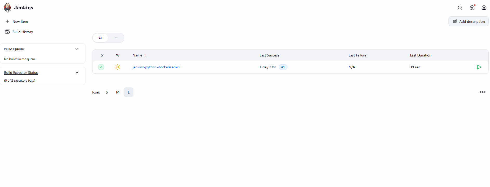
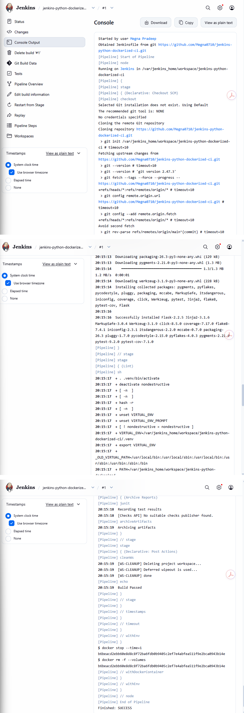
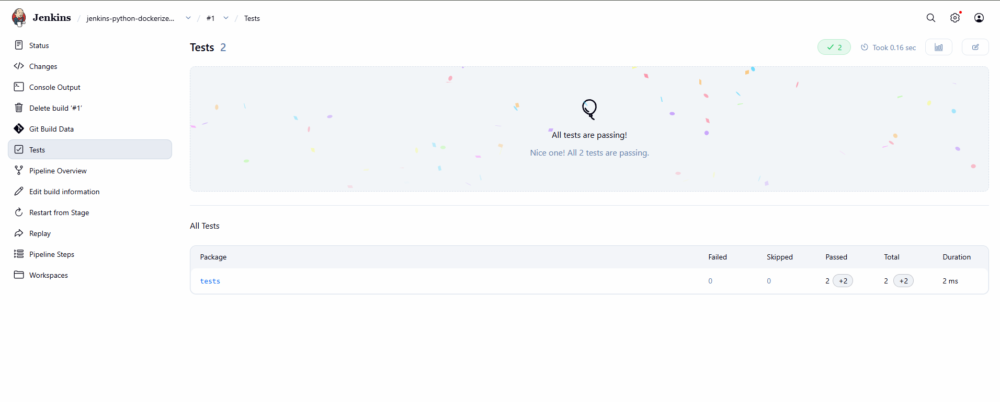
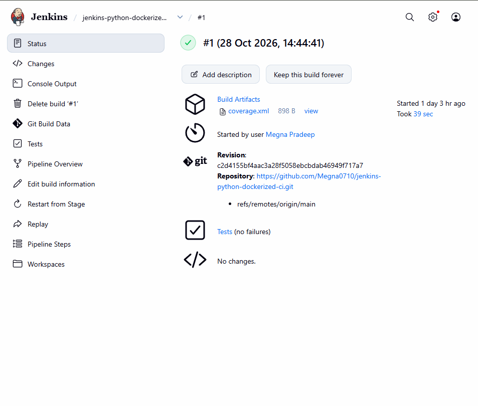

# Jenkins Python Dockerized CI

A Python project demonstrating **Continuous Integration (CI)** using Jenkins, Docker, Git, and GitHub. This project automates dependency installation, code linting, automated testing, test-result reporting, and build-artifact archiving through a Jenkins pipeline.

**Repository:** [jenkins-python-dockerized-ci](https://github.com/Megna0710/jenkins-python-dockerized-ci)

## Project Highlights

- Jenkins Declarative Pipeline defined in a `Jenkinsfile`
- GitHub source-code integration
- Docker-based pipeline execution
- Automated Python linting and testing
- Jenkins test-result reporting
- Test coverage report archived as `coverage.xml`
- Workspace and temporary-container cleanup

## Technology Stack

| Technology | Purpose |
|---|---|
| Python | Application and test code |
| Jenkins | CI pipeline automation |
| Docker | Containerized execution |
| Git and GitHub | Version control and source hosting |
| pytest | Automated testing |
| pytest-cov / coverage | Test coverage reporting |
| flake8 | Python code-quality checks |

## CI Pipeline Workflow

1. **Checkout SCM** — retrieves the source code from GitHub.
2. **Install Dependencies** — prepares the Python environment and installs required packages.
3. **Lint** — runs Python code-quality checks.
4. **Test** — executes automated tests.
5. **Archive Reports** — records test results and archives `coverage.xml`.
6. **Cleanup** — removes the pipeline workspace and temporary Docker resources.

The exact stages and commands are defined in the repository's `Jenkinsfile`.

## Successful Build Results

The captured Jenkins build completed successfully.

| Metric | Result |
|---|---:|
| Build status | Success |
| Build duration | 39 seconds |
| Tests passed | 2 |
| Tests failed | 0 |
| Tests skipped | 0 |
| Archived artifact | `coverage.xml` |

*These results reflect the captured build and may change with subsequent code changes.*

## Project Screenshots

The screenshots below document the Jenkins pipeline execution. Save the corresponding images in the `screenshots/` directory.

### 1. Successful Jenkins Build



### 2. Pipeline Console Output



### 3. Automated Test Results



### 4. Build Artifacts



## Getting Started

### Prerequisites

Install the following tools:

- Git
- Python 3
- Docker Desktop
- Jenkins with the required Pipeline and Git support

### 1. Clone the Repository

```bash
git clone https://github.com/Megna0710/jenkins-python-dockerized-ci.git
cd jenkins-python-dockerized-ci
```

### 2. Set Up Python

On Windows PowerShell:

```powershell
python -m venv .venv
.\.venv\Scripts\Activate.ps1
python -m pip install --upgrade pip
pip install -r requirements.txt
```

On Linux or macOS:

```bash
python3 -m venv .venv
source .venv/bin/activate
python -m pip install --upgrade pip
pip install -r requirements.txt
```

### 3. Run the Tests

Run the test command configured in the project's `Jenkinsfile`. If the test suite uses pytest, execute:

```bash
pytest
```

Run the configured linting command as well to reproduce the pipeline's code-quality checks locally.

## Configure the Jenkins Pipeline

1. Start Jenkins and ensure it can access Docker.
2. Create a new **Pipeline** job.
3. Select **Pipeline script from SCM**.
4. Choose **Git** as the source control system.
5. Enter the repository URL:

   `https://github.com/Megna0710/jenkins-python-dockerized-ci.git`

6. Select the repository's branch, such as `main`.
7. Set the script path to `Jenkinsfile`.
8. Save the configuration and select **Build Now**.
9. Review **Console Output**, **Tests**, and **Build Artifacts** to verify the result.

The required plugins and installed tools depend on the pipeline configuration.

## Example Repository Structure

```text
jenkins-python-dockerized-ci/
├── screenshots/
│   ├── jenkins-build-success.png
│   ├── pipeline-console.png
│   ├── test-results.png
│   └── coverage-artifact.png
├── Jenkinsfile
├── Dockerfile
├── requirements.txt
├── tests/
└── README.md
```

This is an illustrative structure. Retain all existing application files and folders in your actual repository.

## Skills Demonstrated

- CI pipeline design using Jenkins Pipeline as Code
- Git and GitHub integration
- Python dependency management
- Automated testing and linting
- Docker-based CI execution
- Test-result reporting and artifact archiving
- Pipeline monitoring and troubleshooting

## Future Enhancements

- Configure GitHub webhooks for automatic build triggers
- Add pull-request validation
- Enforce test-coverage thresholds
- Publish Docker images to a container registry
- Introduce deployment stages where appropriate
- Add a Jenkins build-status badge

## Author

**Megna Pradeep**

- GitHub: [Megna0710](https://github.com/Megna0710)
- Project Repository: [Jenkins Python Dockerized CI](https://github.com/Megna0710/jenkins-python-dockerized-ci)


